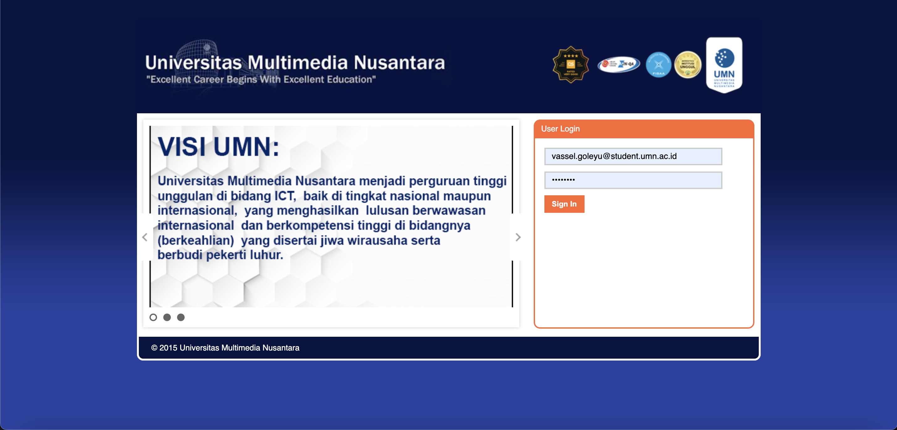
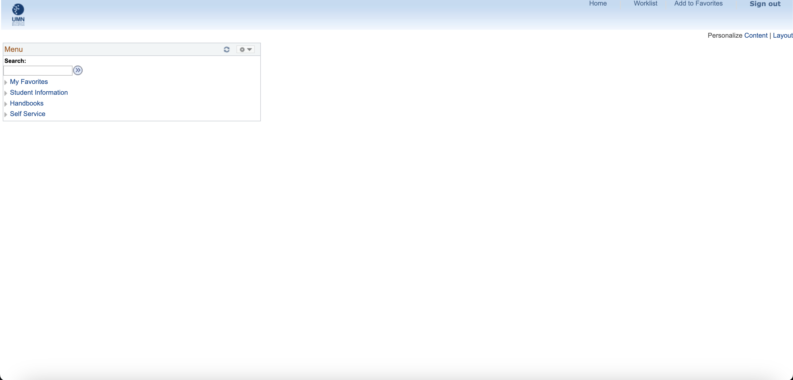
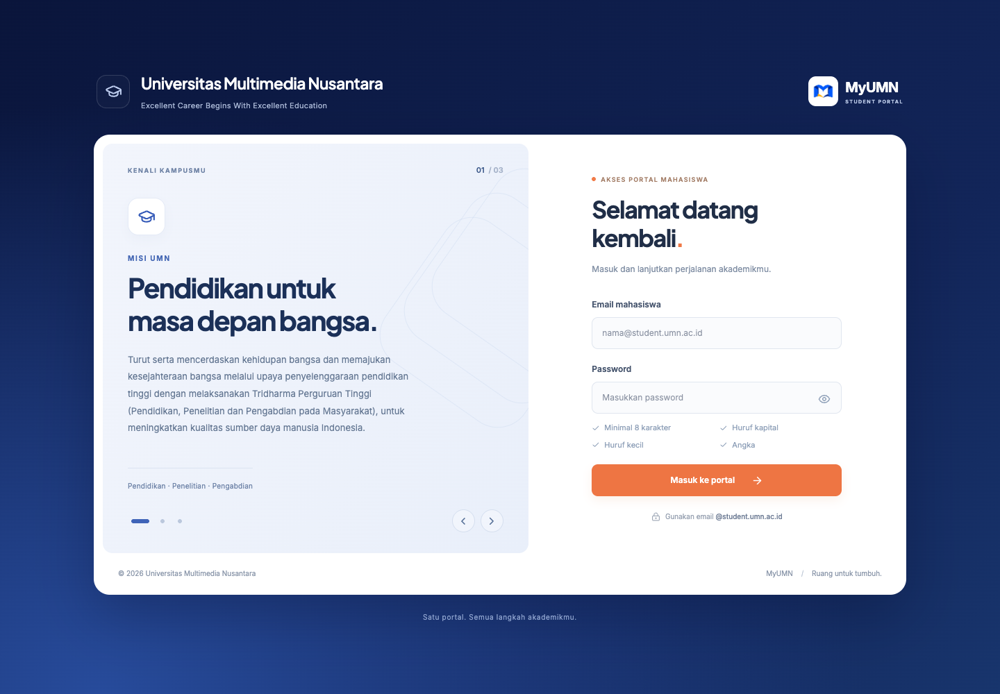
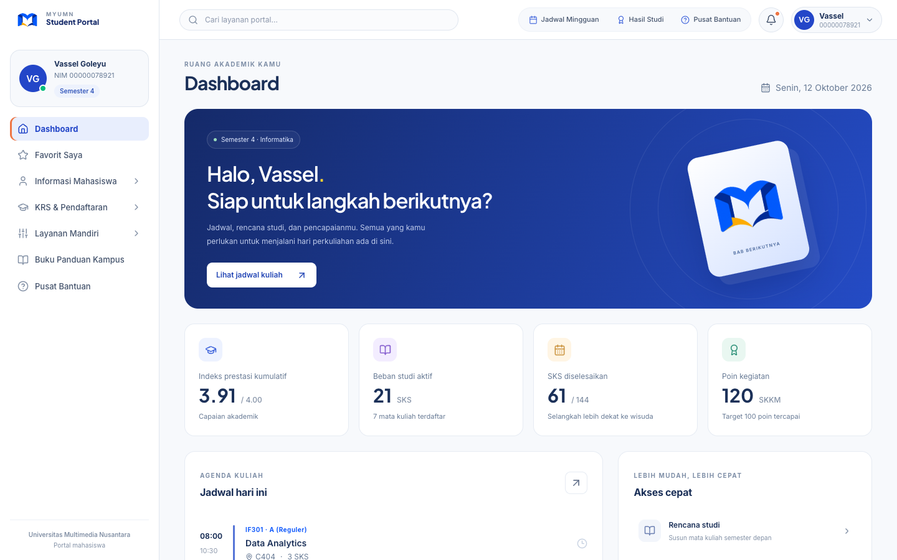
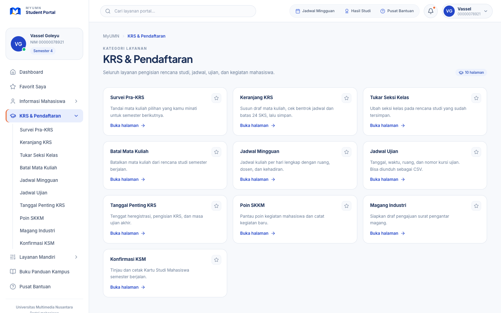
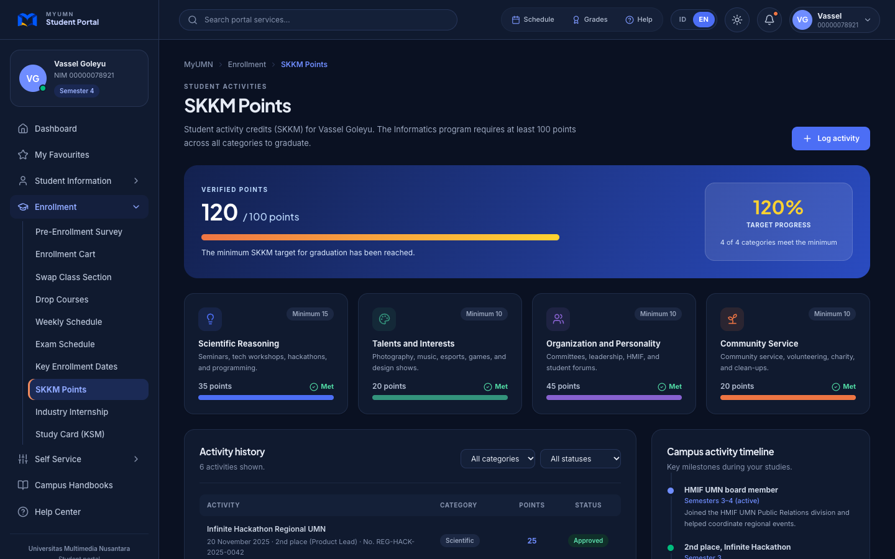

# Redesign Portal Mahasiswa UMN (MyUMN)

Redesain tampilan dan pengalaman pengguna portal mahasiswa Universitas Multimedia Nusantara (MyUMN). Portal lama bergaya PeopleSoft dengan menu pohon yang kaku; versi ini dibuat ulang agar lebih bersih, konsisten, dan nyaman dipakai di desktop maupun ponsel. Proyek ini adalah **konsep desain dengan data contoh**, bukan portal resmi universitas.

## Sebelum dan sesudah

**Portal lama**

| Halaman masuk | Menu utama |
|---|---|
|  |  |

**Hasil redesain**

| Halaman masuk | Dashboard |
|---|---|
|  |  |

| Menu kategori | Mode gelap |
|---|---|
|  |  |

## Yang berubah

- Desain terpadu: navy, biru kobalt, dan aksen oranye di seluruh halaman.
- Sidebar bertingkat; mengklik kategori membuka halaman daftar isinya dan posisi aktif diberi warna.
- Dua bahasa (Indonesia / English) dan mode terang / gelap.
- Dashboard ringkas, pencarian layanan, favorit, dan tampilan responsif untuk ponsel.

## Menjalankan proyek

Memerlukan Node.js 20.19+ atau 22.12+.

```sh
npm install
npm run dev
```

Buka http://localhost:3000. Untuk validasi dan build:

```sh
npm run check
npm test
npm run build
npm run preview
```

## Fitur

- Halaman login dengan informasi kampus bergeser, validasi input, dan tombol keluar.
- Sidebar dimulai tertutup. Mengklik kategori atau sub-kategori membuka halaman direktori berisi seluruh halaman di dalamnya, sekaligus membuka submenu dan menandai posisi aktif dengan warna. Panah di kanan hanya membuka/menutup submenu; berpindah kategori utama mereset submenu sebelumnya.
- Dashboard dengan jadwal sesuai hari di zona waktu Jakarta, ringkasan studi, dan pengumuman.
- Pencarian layanan, navigasi dengan riwayat browser, serta menu favorit.
- Keranjang KRS dengan pemeriksaan duplikasi, kuota, batas 24 SKS, dan bentrok jadwal.
- Jadwal mingguan, ekspor jadwal ujian dan rencana studi sebagai CSV, serta cetak KSM lokal.
- Data kontak, minat studi, kegiatan, tiket bantuan, dan balasan tersimpan di browser.
- Pilihan bahasa Indonesia / English dan mode terang / gelap untuk seluruh portal, termasuk halaman masuk. Tombolnya ada di header (desktop), menu profil (ponsel), dan pojok kanan atas halaman masuk. Pilihan tersimpan di browser; tema awal mengikuti pengaturan perangkat.
- Seluruh halaman memakai gaya visual yang sama dengan halaman masuk: biru kobalt, navy, dan aksen oranye. Warna diatur lewat token CSS di `src/index.css`, dan cetak KSM selalu memakai tema terang.
- Pencarian layanan juga tersedia di layar ponsel; Enter membuka hasil teratas.
- Tampilan responsif, fokus keyboard, mode cetak, dan dukungan reduced motion.

## Batasan integrasi

Data adalah contoh, bukan data langsung dari universitas. Login menerima setiap email berakhiran `@student.umn.ac.id` dengan password minimal 8 karakter yang memuat huruf kapital, huruf kecil, dan angka. Sesi berada di sessionStorage dan password tidak disimpan. Validasi ini hanya pada frontend, bukan autentikasi akun kampus. Tidak ada backend, autentikasi SSO, pembayaran, pengiriman tiket, unggah dokumen ke kampus, atau persetujuan akademik resmi. Formulir bekerja secara lokal; berkas ekspor bukan dokumen resmi. Penyimpanan memakai localStorage pada browser yang sama; jangan memasukkan informasi pribadi asli. Jika penyimpanan browser dibatasi, aplikasi tetap dapat digunakan pada sesi berjalan.

Logo: `public/myumn-mark.png`. Hapus data situs melalui pengaturan browser untuk mengembalikan data contoh. Deployment belum dikonfigurasi; folder `dist` dapat digunakan pada hosting statis.

Hasil pemeriksaan: [docs/verification.md](docs/verification.md). Pratinjau mobile: [halaman masuk](docs/baru-login-mobile.png).
